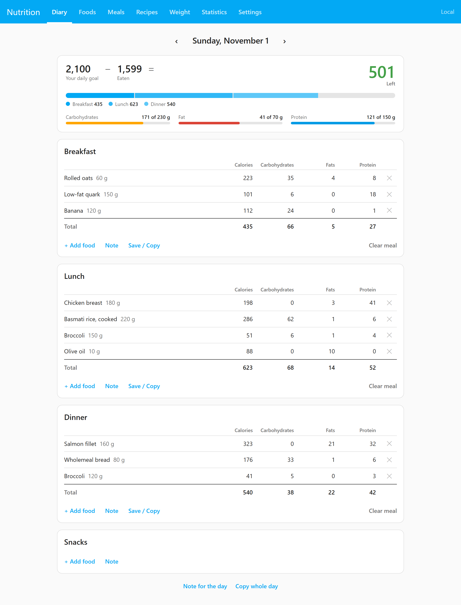
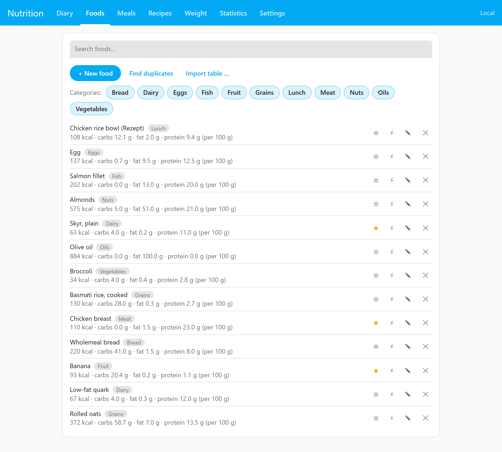
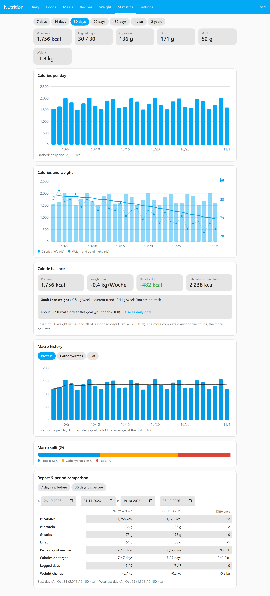
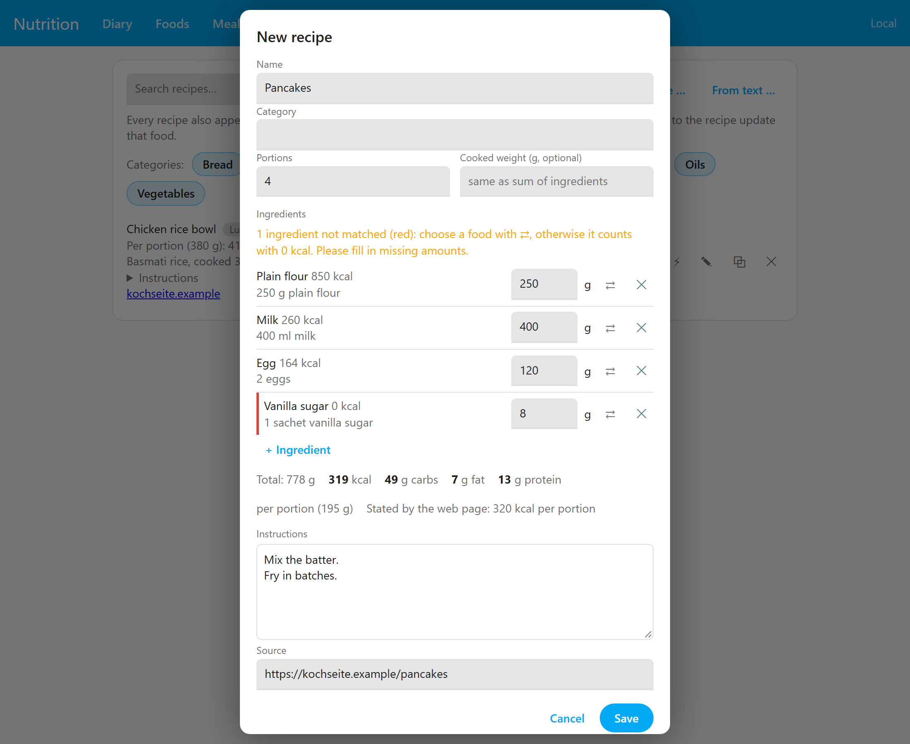
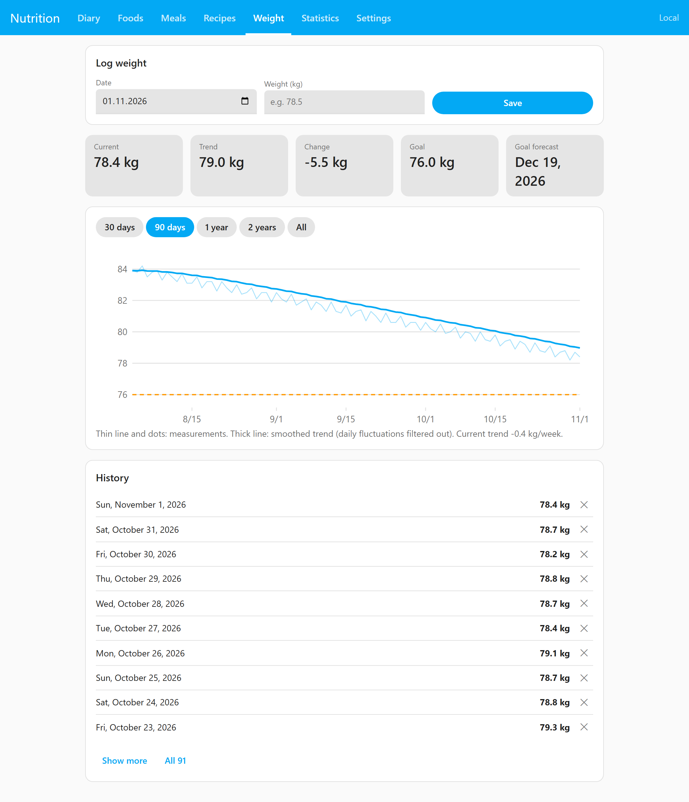
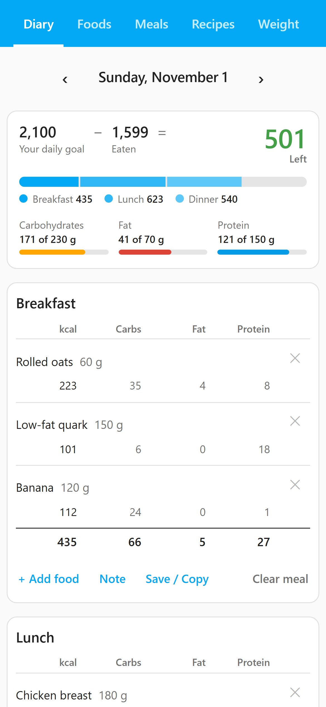

# MyDietAssistant

**English** · [Deutsch](README.md)

[](https://github.com/Schumey/MyDietAssistant/actions/workflows/test.yml)
[](https://github.com/Schumey/MyDietAssistant/actions/workflows/lint.yml)

**Your food diary in Home Assistant.** Track calories, macros and weight like in MyFitnessPal, without a cloud account: everything lives in an SQLite file on your Home Assistant device and is part of the normal HA backup. Home Assistant adds sensors, triggers and automations. For Android there is a dedicated app with a barcode scanner and a widget.

[](https://my.home-assistant.io/redirect/supervisor_add_addon_repository/?repository_url=https%3A%2F%2Fgithub.com%2FSchumey%2FMyDietAssistant)

<p align="center"></p>

## At a glance

| | |
|---|---|
| **What** | Home Assistant app (formerly “add-on”) with a web interface in the HA sidebar |
| **Where the data lives** | only locally: `/data/mydiet.db`, plus daily JSON backups |
| **Who** | every HA account has its own diary; households can share entries and foods |
| **How** | browser, Companion app or the [Android app](#android-app) |
| **Languages** | German, English, French, Spanish, Dutch, Italian, Portuguese, Polish; metric and imperial |
| **Internet** | only for the optional online databases (Open Food Facts, USDA) and recipe import |

## Features

**Daily logging**
- Diary with freely named meals (breakfast, night shift, PWO …) or by time of day, calorie budget on top, swipe between days and tabs on phones
- Foods with categories, serving sizes and favourites; barcode by camera, photo or typing; online search in Open Food Facts and USDA
- Save, copy and share meals; create recipes or import them from websites and Mealie
- Quick entry with kcal only, voice entry through Home Assistant (“two apples and 200 g skyr”)

**Goals and analysis**
- Lose, maintain or gain; goals per weekday and profiles, switchable by triggers
- Statistics from 7 days to 2 years: calories and macros with goal lines, **energy balance** from weight trend and intake, forecast to your goal weight
- Mark days as incomplete so they don't distort the statistics

**Home Assistant**
- Sensors for calories, macros, remaining, weekly average, weight and balance (also via MQTT discovery)
- Triggers: add or show foods and meals automatically, depending on states, calendars or time
- Interface for automations (scale, voice assistant), reminder by notification, shopping list to an HA to-do list

**Optional** (off by default, turn on in the settings): weekday goals, water and supplements, recipes, more nutrients, notes, body measurements and progress photos, online sync, activity, scale, meal schedule, meal suggestions, shopping list, household

**Data:** import from MyFitnessPal, Cronometer, FDDB, Yazio, Apple Health and Google Fit; export as JSON and CSV; report for coaches and trainers; automatic backups.

<p align="center">
  
  
</p>
<p align="center">
  
  
</p>

The pictures show the default Home Assistant theme with sample data. The interface follows your HA theme; for retro themes like “HA 95/98” there is a matching Windows look.

## Installation

MyDietAssistant is an **app** (called “add-on” until HA 2026.1) and needs Home Assistant OS or Supervised. You won't find it in the **Marketplace** (since HA 2026.11, the successor of HACS): the Marketplace installs integrations, cards and themes, but no apps.

1. Add the repository: with the button above or by hand under **Settings → Apps → Install app → ⋮ → Repositories** → `https://github.com/Schumey/MyDietAssistant`.
2. Install and start **MyDietAssistant** and turn on **Show in sidebar**.
3. Open it, set your goal, get going. [First steps](docs/en/first-steps.md) walks you through the setup.

Updates show up under **Settings → Updates**. In detail: [Installation](docs/en/installation.md).

## Android app

<p align="center"></p>

The web interface also runs in the Companion app. The dedicated Android app adds:

- **Full screen** without the HA sidebar, login through the normal HA login page
- **System barcode scanner** (fast, no HTTPS and no camera permission needed)
- **Home screen widget**: today's calories, what is left of your goal, buttons **Scan** and **Add**

- **Health Connect:** take over weight, steps and active calories from the phone
- **Updates** right inside the app

**[Download the APK](https://github.com/Schumey/MyDietAssistant-Android/releases/latest)** (Android 8 or newer) · [source and versions](https://github.com/Schumey/MyDietAssistant-Android) · [guide](docs/en/android.md)

The app is not in the Play Store, so Android asks during installation whether to allow apps from this source. Afterwards the app finds new versions itself.

## Documentation

Step-by-step guides for every topic: **[docs/en](docs/en/README.md)** ([Deutsch](docs/de/README.md)). Common problems: [Troubleshooting](docs/en/troubleshooting.md). Changes: [CHANGELOG](mydiet/CHANGELOG.en.md). Ideas and plans: [roadmap.md](roadmap.md) (German).

## Bring your data

Under *Settings → Data* you import a MyFitnessPal CSV, and under “More imports …” also Cronometer, FDDB, Yazio, Google Fit and Apple Health. Columns are recognised by their headers and can be corrected before the import. More: [Data, import and backup](docs/en/data.md).

## Development

```
pip install fastapi httpx pydantic uvicorn pytest
python -m pytest
cd mydiet/app
MYDIET_DB=./dev.db uvicorn main:app --port 8099
```

Then open `http://localhost:8099/`. Without Home Assistant there are no sensors, triggers or entity suggestions. Browser tests (Playwright) run as well once `pip install playwright && python -m playwright install chromium` is done.

| Folder | Content |
|---|---|
| `mydiet/` | the Home Assistant app: `app/main.py` (core API), `app/extras*.py` (one feature area each), `app/db.py` (schema and migrations), `app/static/` (interface without a build step) |
| `docs/` | guides (de/en) and screenshots |
| `tests/` | pytest suite, `tests/e2e` with Playwright |

The Android app lives in its own repository: [Schumey/MyDietAssistant-Android](https://github.com/Schumey/MyDietAssistant-Android). Notes for development are in [CLAUDE.md](CLAUDE.md) (German). Prebuilt container images for the HA app are described under [Installation → Prebuilt images](docs/en/installation.md#prebuilt-images-for-developers).

## License

MIT, see [LICENSE](LICENSE). The bundled barcode fallback [ZXing](https://github.com/zxing-js/library) is licensed under Apache-2.0 (`mydiet/app/static/vendor/ZXING-LICENSE.txt`).
