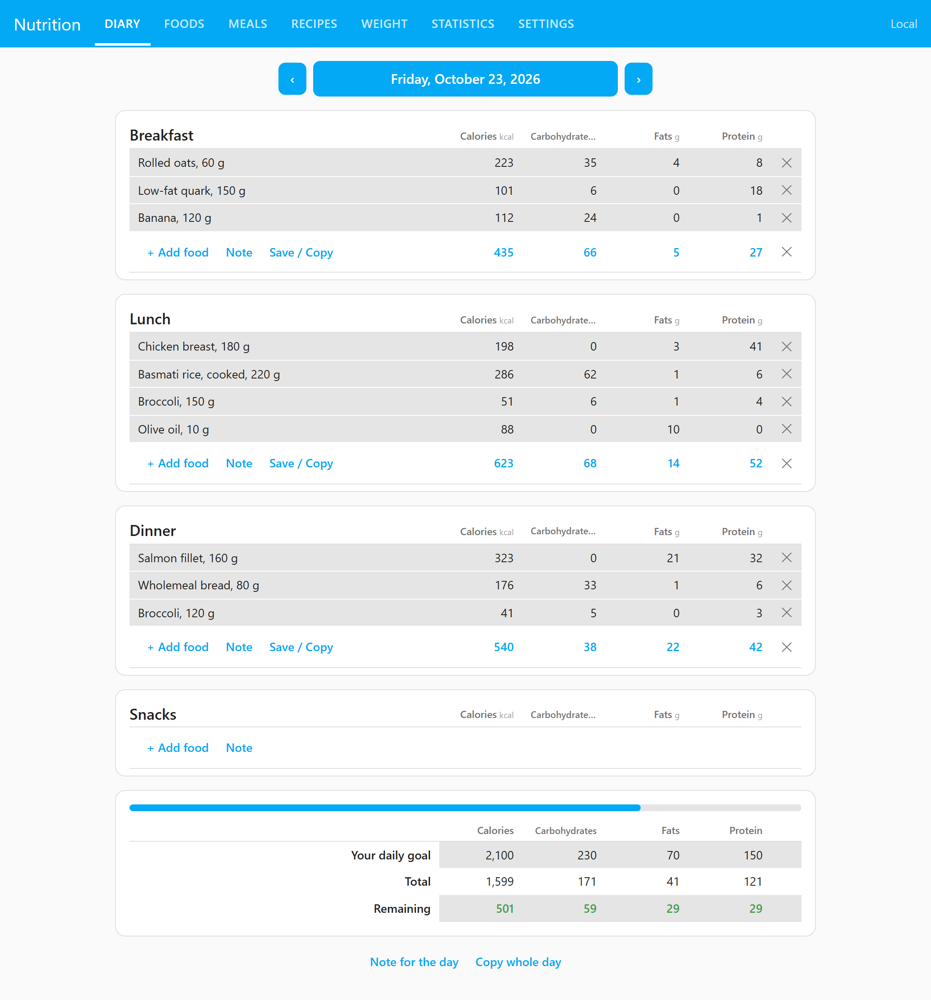
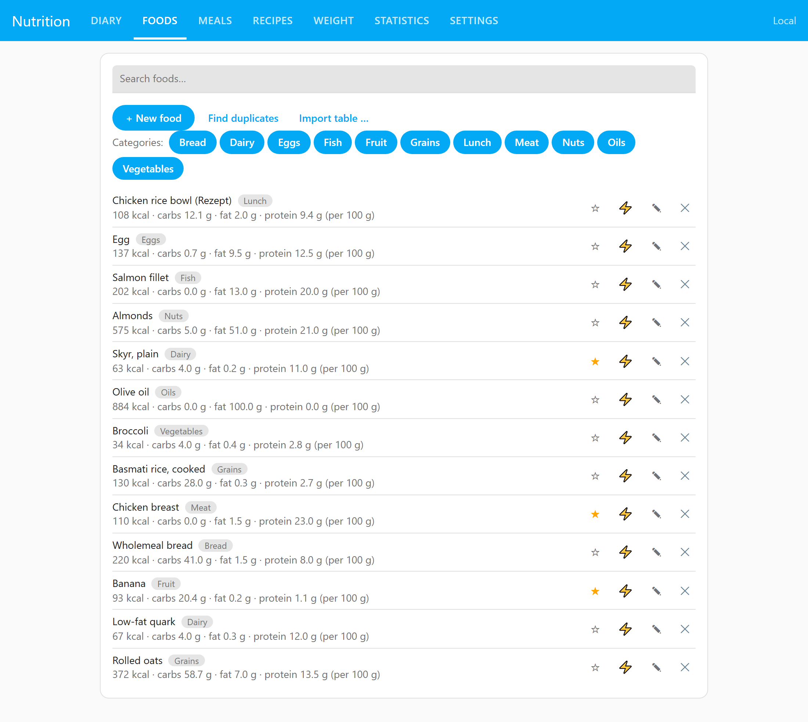
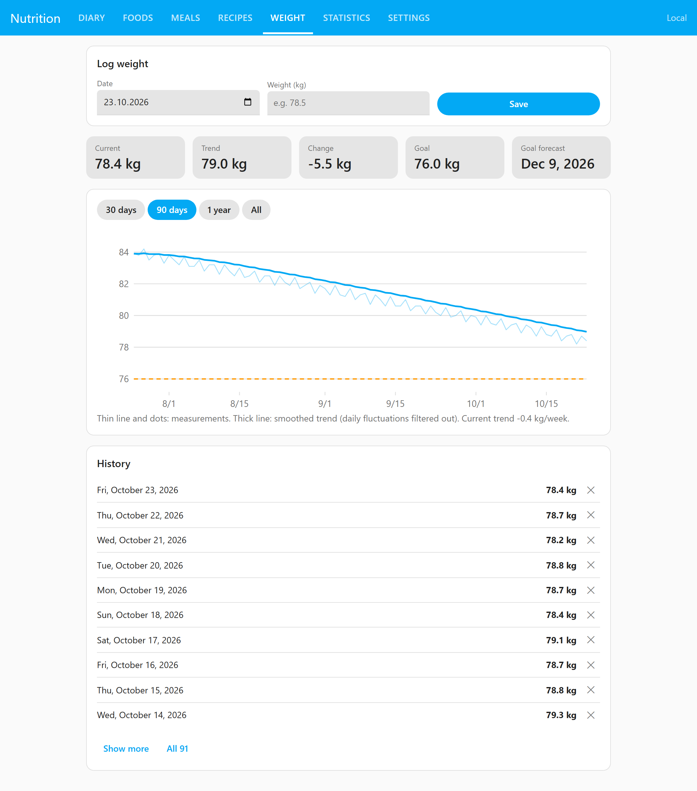
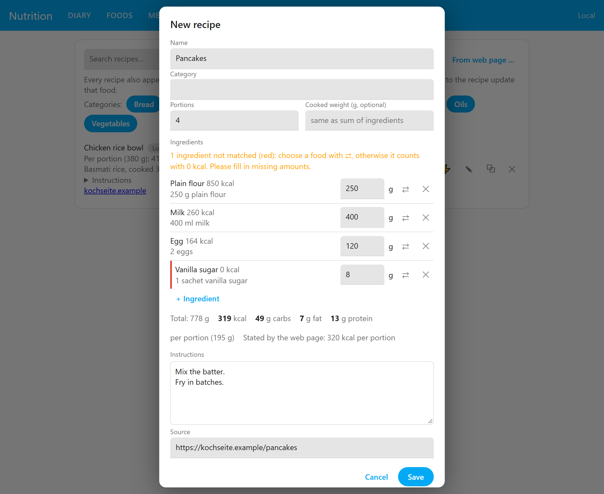
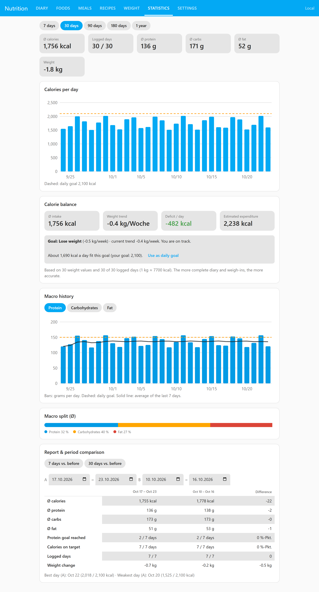
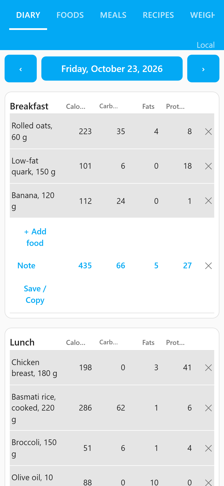

# MyDietAssistant

**English** · [Deutsch](README.md)

[](https://github.com/Schumey/MyDietAssistant/actions/workflows/test.yml)
[](https://github.com/Schumey/MyDietAssistant/actions/workflows/lint.yml)

[](https://my.home-assistant.io/redirect/supervisor_add_addon_repository/?repository_url=https%3A%2F%2Fgithub.com%2FSchumey%2FMyDietAssistant)

A local food diary in the style of MyFitnessPal, as a **Home Assistant add-on**. Calories, macros, weight, triggers from Home Assistant and analyses; everything stays with you: the data lives in a SQLite file in the add-on storage and is part of the HA backup. Only the optional online databases (Open Food Facts, USDA) need the internet.

The interface runs through ingress in the HA sidebar, adopts the active HA theme (automatically a Windows look for themes named "HA 95/98", configurable), is available in German, English, French and Spanish (metric and imperial) and separates users by their HA account.

<p align="center"></p>

## Features

- **Diary** with freely named meals (breakfast, night shift, PWO …) or by time of day; calories, carbs, fat, protein, daily goal and remaining; save, copy and share meals; swipe between days on a phone
- **Foods** with categories, portion sizes, favorites, barcode (camera, photo or typing, with a fallback scanner for iPhone and Firefox); table import (BLS, CSV, Excel)
- **Goals:** lose, maintain or gain; goals per weekday and profiles, switchable by trigger
- **Statistics** from 7 days to 1 year: calorie and macro history with goal lines, **calorie balance** from weight trend and intake, forecast to the target weight
- **Triggers:** log foods or meals automatically, show meals only on certain days, depending on HA states, calendar or time of day
- **Recipes** with preparation steps; **import from web pages** (schema.org data, ingredients converted to grams and matched to your foods)
- **HA sensors** for calories, macros, remaining, weekly average, weight, balance and the current meal (plain states or MQTT discovery); an interface for automations (scale, voice assistant)
- **Import/export:** JSON backup, CSV, MyFitnessPal, Cronometer, FDDB, Yazio, Apple Health, Google Fit; report and table for advisors and trainers
- **Optional features** (off by default): weekday goals, water and supplements, recipes, more nutrients, notes, body measurements and progress photos, online databases with comparison, activity, scale (weight from an HA sensor), meal schedule, meal suggestions from the open macros, household (several users share entries, foods and meals)
- **User administration** for administrators, automatic backups, reminder by notification

<p align="center">
  
  
</p>
<p align="center">
  
  
</p>
<p align="center"></p>

Details on options, sensors and usage: [mydiet/DOCS.md](mydiet/DOCS.md) (German). Changes: [mydiet/CHANGELOG.en.md](mydiet/CHANGELOG.en.md). Ideas: [roadmap.md](roadmap.md) (German). The screenshots show the Home Assistant default theme with demo data; more in [docs/screenshots](docs/screenshots).

## Installation

1. Add the repository: with the button above (opens your Home Assistant instance through my.home-assistant.io) or manually: HA → Settings → Add-ons → Add-on store → ⋮ → **Repositories** → `https://github.com/Schumey/MyDietAssistant`. (For a private repository, copy the folder `mydiet` to `/addons` instead.)
2. Install and start **MyDietAssistant**, enable "Show in sidebar".

After updates: reload the add-on store and update the add-on (rebuild for local add-ons).

### Prebuilt images (optional)

By default Home Assistant builds the add-on itself on installation. The workflow `.github/workflows/build.yml` can publish prebuilt images (amd64, aarch64) to the GitHub Container Registry instead: `git tag v<version>` and `git push --tags` (the version must match `mydiet/config.yaml`), or run "Build images" manually under Actions. Then set the packages `mydiet-amd64` and `mydiet-aarch64` to **public** under GitHub → Packages and add the line `image: ghcr.io/schumey/mydiet-{arch}` to `mydiet/config.yaml`. From then on, installs and updates only pull the image (faster, no building on the HA device). Only set the line once the images of that version exist, otherwise the installation fails.

## Bringing your data over

Settings → Data: MyFitnessPal CSV, or under "More imports …" Cronometer, FDDB, Yazio, Google Fit and Apple Health. Columns are recognized by their headings and can be corrected before the import.

## Development

```
pip install fastapi httpx pydantic uvicorn pytest
python -m pytest
cd mydiet/app
MYDIET_DB=./dev.db uvicorn main:app --port 8099
```

Then open `http://localhost:8099/`. Without Home Assistant there are no sensors, triggers or entity suggestions; meals with visibility rules are always shown locally.

Browser tests (Playwright, skipped if not installed): `pip install playwright && python -m playwright install chromium`, after which `python -m pytest` also runs `tests/e2e`.

Structure: `mydiet/app/main.py` (core API) and `extras*.py` (one feature area each), `db.py` (schema and migrations), `static/` (interface without a build step), `tests/` (pytest). Notes for development are in [CLAUDE.md](CLAUDE.md) (German).

The barcode fallback uses [ZXing](https://github.com/zxing-js/library) (Apache-2.0, license in `mydiet/app/static/vendor/ZXING-LICENSE.txt`).

## License

MIT, see [LICENSE](LICENSE). The bundled ZXing library is under Apache-2.0.
