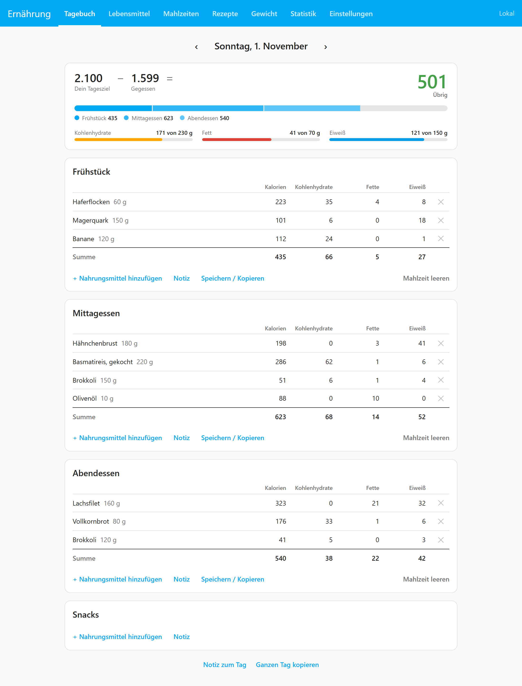
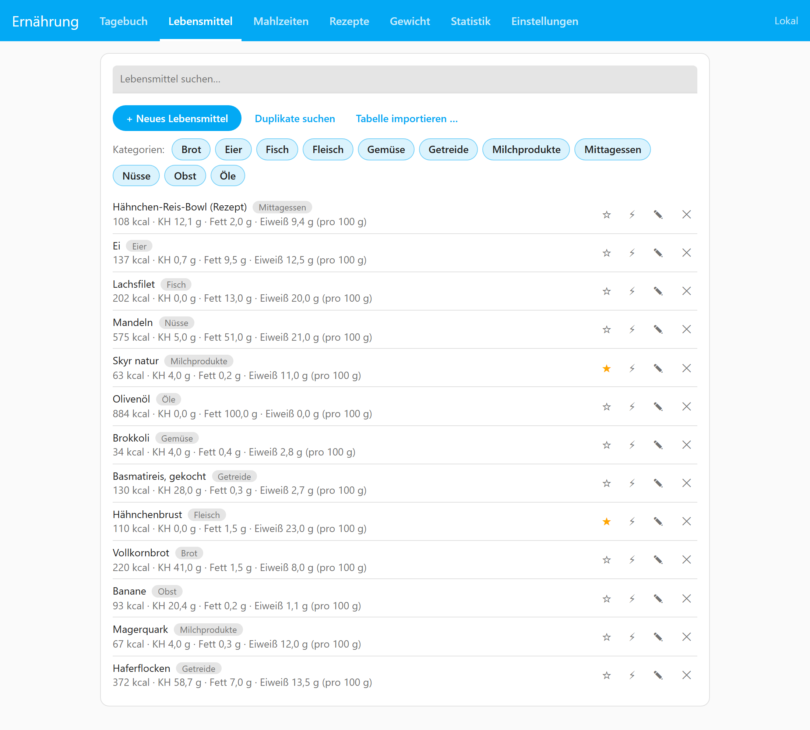
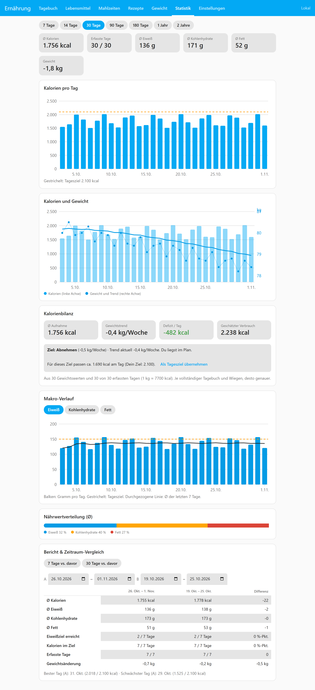
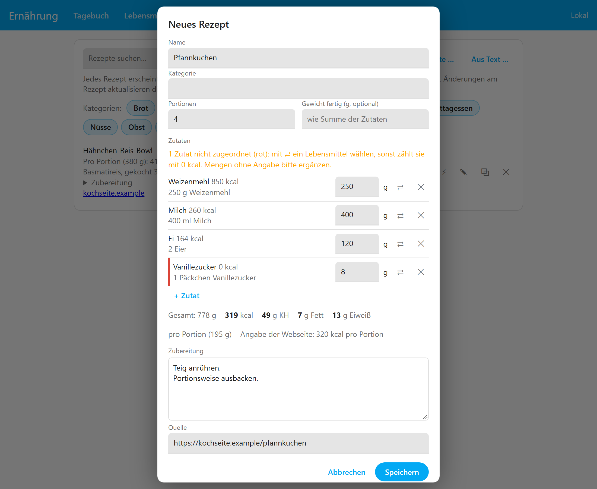
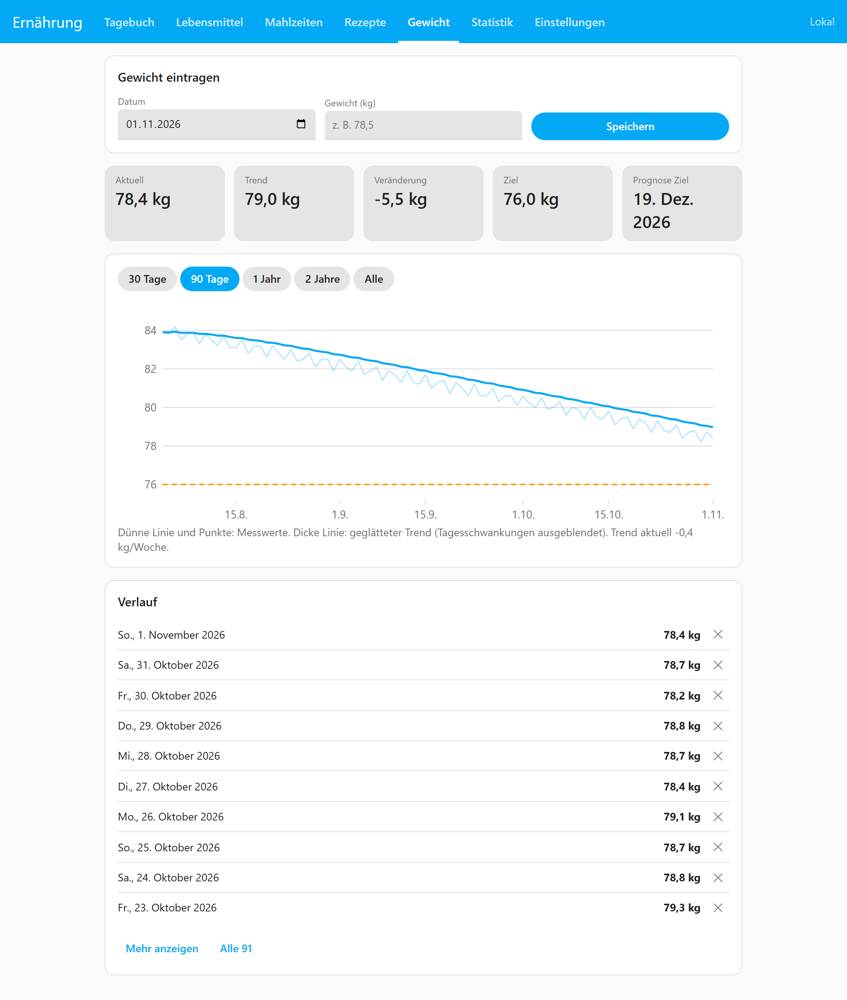
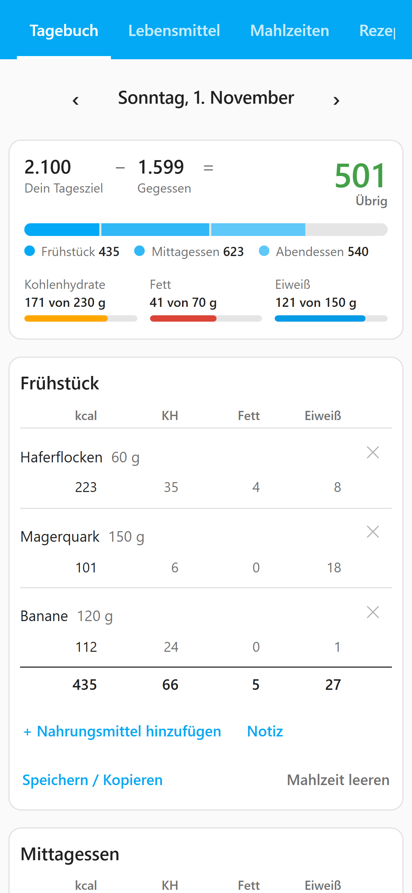

# MyDietAssistant

[English](README.en.md) · **Deutsch**

[](https://github.com/Schumey/MyDietAssistant/actions/workflows/test.yml)
[](https://github.com/Schumey/MyDietAssistant/actions/workflows/lint.yml)

**Dein Ernährungstagebuch in Home Assistant.** Kalorien, Makros und Gewicht erfassen wie bei MyFitnessPal, nur ohne Cloud-Konto: Alles liegt in einer SQLite-Datei auf Deinem Home-Assistant-Gerät und ist im normalen HA-Backup enthalten. Home Assistant liefert Sensoren, Trigger und Automationen dazu. Für Android gibt es eine eigene App mit Barcode-Scanner und Widget.

[](https://my.home-assistant.io/redirect/supervisor_add_addon_repository/?repository_url=https%3A%2F%2Fgithub.com%2FSchumey%2FMyDietAssistant)

<p align="center"></p>

## Auf einen Blick

| | |
|---|---|
| **Was** | Home-Assistant-App (früher „Add-on“) mit Weboberfläche im HA-Seitenmenü |
| **Wo laufen die Daten** | nur lokal: `/data/mydiet.db`, dazu tägliche JSON-Sicherungen |
| **Wer** | jedes HA-Konto hat sein eigenes Tagebuch; Haushalte können Einträge und Lebensmittel teilen |
| **Wie** | Browser, Companion-App oder die [Android-App](#android-app) |
| **Sprachen** | Deutsch, Englisch, Französisch, Spanisch, Niederländisch, Italienisch, Portugiesisch, Polnisch; metrisch und imperial |
| **Internet** | nur für die optionalen Online-Datenbanken (Open Food Facts, USDA) und den Rezept-Import |

## Funktionen

**Tägliches Eintragen**
- Tagebuch mit frei benennbaren Mahlzeiten (Frühstück, Nachtschicht, PWO …) oder nach Uhrzeiten, Kalorienbudget oben, Wischen zwischen Tagen und Reitern auf dem Handy
- Lebensmittel mit Kategorien, Portionsgrößen und Favoriten; Barcode per Kamera, Foto oder Eingabe; Online-Suche in Open Food Facts und USDA
- Mahlzeiten speichern, kopieren und teilen; Rezepte anlegen oder von Webseiten und aus Mealie importieren
- Schnelleingabe nur mit kcal, Sprach-Eintrag über Home Assistant („zwei Äpfel und 200 g Skyr“)

**Ziele und Auswertung**
- Abnehmen, Halten oder Zunehmen; Ziele pro Wochentag und Profile, per Trigger umschaltbar
- Statistik von 7 Tagen bis 2 Jahre: Kalorien und Makros mit Ziellinien, **Kalorienbilanz** aus Gewichtstrend und Aufnahme, Prognose zum Zielgewicht
- Tage als unvollständig markieren, damit sie die Statistik nicht verfälschen

**Home Assistant**
- Sensoren für Kalorien, Makros, Rest, Wochenschnitt, Gewicht und Bilanz (auch per MQTT Discovery)
- Trigger: Lebensmittel oder Mahlzeiten automatisch eintragen oder einblenden, abhängig von Zuständen, Kalender oder Uhrzeit
- Schnittstelle für Automationen (Waage, Sprachassistent), Erinnerung per Benachrichtigung, Einkaufsliste an eine HA-Todo-Liste

**Optional** (standardmäßig aus, in den Einstellungen einschaltbar): Wochentagsziele, Wasser und Ergänzungen, Rezepte, weitere Nährwerte, Notizen, Körpermaße und Fortschrittsfotos, Online-Abgleich, Aktivität, Waage, Mahlzeiten-Zeitplan, Mahlzeiten-Vorschläge, Einkaufsliste, Haushalt

**Daten:** Import aus MyFitnessPal, Cronometer, FDDB, Yazio, Apple Health und Google Fit; Export als JSON und CSV; Bericht für Berater und Trainer; automatische Sicherungen.

<p align="center">
  
  
</p>
<p align="center">
  
  
</p>

Die Bilder zeigen das Standard-Theme von Home Assistant mit Beispieldaten. Die Oberfläche übernimmt Dein HA-Theme; zu Retro-Themes wie „HA 95/98“ gibt es einen passenden Windows-Look.

## Installation

MyDietAssistant ist eine **App** (bis HA 2026.1 „Add-on“) und braucht Home Assistant OS oder Supervised. Im **Marketplace** (seit HA 2026.11, Nachfolger von HACS) findest Du sie nicht: Der Marketplace installiert Integrationen, Karten und Themes, aber keine Apps.

1. Repository hinzufügen: mit dem Knopf oben oder von Hand unter **Einstellungen → Apps → App installieren → ⋮ → Repositories** → `https://github.com/Schumey/MyDietAssistant`.
2. **MyDietAssistant** installieren, starten und **In Seitenleiste anzeigen** einschalten.
3. Öffnen, Ziel festlegen, loslegen. Die [Ersten Schritte](docs/de/first-steps.md) führen durch die Einrichtung.

Updates erscheinen unter **Einstellungen → Updates**. Ausführlich: [Installation](docs/de/installation.md).

## Android-App

<p align="center"></p>

Die Weboberfläche läuft auch in der Companion-App. Die eigene Android-App bietet zusätzlich:

- **Vollbild** ohne HA-Seitenleiste, Anmeldung über die normale HA-Anmeldeseite
- **Barcode-Scanner des Systems** (schnell, ohne HTTPS und ohne Kamera-Berechtigung)
- **Widget** für den Startbildschirm: Kalorien von heute, Rest bis zum Ziel, Knöpfe **Scannen** und **Eintragen**

- **Health Connect:** Gewicht, Schritte und aktive Kalorien vom Handy übernehmen
- **Updates** direkt in der App

**[APK herunterladen](https://github.com/Schumey/MyDietAssistant-Android/releases/latest)** (Android 8 oder neuer) · [Quellcode und Versionen](https://github.com/Schumey/MyDietAssistant-Android) · [Anleitung](docs/de/android.md)

Die App gibt es nicht im Play Store. Android fragt deshalb bei der Installation, ob Du Apps aus dieser Quelle zulassen willst. Neue Versionen findet die App danach selbst.

## Dokumentation

Schritt-für-Schritt-Anleitungen für jedes Thema: **[docs/de](docs/de/README.md)** ([English](docs/en/README.md)). Häufige Probleme: [Fehlersuche](docs/de/troubleshooting.md). Änderungen: [CHANGELOG](mydiet/CHANGELOG.md). Ideen und Pläne: [roadmap.md](roadmap.md).

## Daten übernehmen

Unter *Einstellungen → Daten* importierst Du eine MyFitnessPal-CSV, unter „Weitere Importe …“ auch Cronometer, FDDB, Yazio, Google Fit und Apple Health. Die Spalten werden anhand der Überschriften erkannt und lassen sich vor dem Import korrigieren. Mehr: [Daten, Import und Sicherung](docs/de/data.md).

## Entwicklung

```
pip install fastapi httpx pydantic uvicorn pytest
python -m pytest
cd mydiet/app
MYDIET_DB=./dev.db uvicorn main:app --port 8099
```

Danach `http://localhost:8099/` öffnen. Ohne Home Assistant gibt es keine Sensoren, Trigger und Entitätsvorschläge. Browser-Tests (Playwright) laufen mit, sobald `pip install playwright && python -m playwright install chromium` erledigt ist.

| Ordner | Inhalt |
|---|---|
| `mydiet/` | die App für Home Assistant: `app/main.py` (Kern-API), `app/extras*.py` (je ein Funktionsbereich), `app/db.py` (Schema und Migrationen), `app/static/` (Oberfläche ohne Build-Schritt) |
| `docs/` | Anleitungen (de/en) und Screenshots |
| `tests/` | pytest-Suite, `tests/e2e` mit Playwright |

Die Android-App liegt in einem eigenen Repository: [Schumey/MyDietAssistant-Android](https://github.com/Schumey/MyDietAssistant-Android). Hinweise für die Weiterentwicklung stehen in [CLAUDE.md](CLAUDE.md). Fertige Container-Images für die HA-App beschreibt [Installation → Fertige Images](docs/de/installation.md#fertige-images-für-entwickler).

## Lizenz

MIT, siehe [LICENSE](LICENSE). Der mitgelieferte Barcode-Rückfall [ZXing](https://github.com/zxing-js/library) steht unter Apache-2.0 (`mydiet/app/static/vendor/ZXING-LICENSE.txt`).
